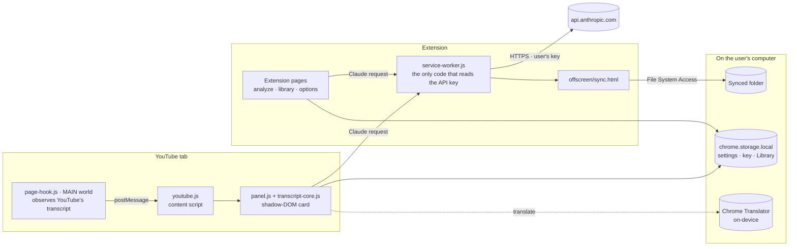

# Clean Transcript & Key Learnings for YouTube

A Chrome extension that turns any YouTube video, or any transcript you paste, into a clean, speaker-grouped
transcript, with Claude's analysis (themes, concepts, key learnings, a company glossary and a concept map),
translation into 39 languages, and a personal, searchable Library.

- **Free by default.** Getting, cleaning, saving, searching and exporting transcripts all run locally.
  Translation uses Chrome's built-in on-device translator.
- **Bring your own key.** Claude features use the user's own Anthropic API key, stored only in their
  browser. There is no backend; the developer never sees keys, transcripts or usage.
- **No build step at runtime.** Plain Manifest V3 JavaScript. Tooling needs Node.js only, with no `npm install`.

---

## Contents

- [Features](#features)
- [Install](#install)
- [Architecture](#architecture)
- [Project structure](#project-structure)
- [Development](#development)
- [Building for the Chrome Web Store](#building-for-the-chrome-web-store)
- [Privacy and cost model](#privacy-and-cost-model)
- [Troubleshooting](#troubleshooting)
- [License](#license)

## Features

|                                                                                             | Needs an API key? | Cost to the user                        |
| ------------------------------------------------------------------------------------------- | ----------------- | --------------------------------------- |
| Clean transcript: timestamps, `[Music]`, "um/uh" and stutters removed                       | No                | Free (local)                            |
| Paste any transcript, or right-click selected text → _Clean & analyze_                      | No                | Free (local)                            |
| Library: search, Markdown/ZIP/PDF export, backup and restore, sync to a folder for Claude   | No                | Free (local)                            |
| Translate the transcript (Chrome's built-in translator, Chrome 138+)                        | No                | Free (on-device)                        |
| Translate with Claude Haiku when Chrome's translator can't run (opt-in, shows an estimate)  | Yes               | About 1¢ per hour of video              |
| Analyze with Claude: speakers, summary, themes, concepts, learnings, companies, concept map | Yes               | ~10–20¢ per hour of video (Sonnet/Opus) |
| Write Claude's analysis in any of 39 languages                                              | Yes               | Same as an analysis                     |
| Trends across the Library, and a map of how the companies in your videos relate             | Yes               | Shown before running                    |
| Copy a ready-made prompt for claude.ai                                                      | No                | Covered by the user's Claude plan       |

The full walkthrough is in the [user guide](docs/user-guide.md).

## Install

**From the Chrome Web Store:** _link to come once the listing is approved._

**From source:**

1. Clone this repository.
2. Open `chrome://extensions`, turn on **Developer mode**, click **Load unpacked**, and select the repository root
   (the folder that contains `manifest.json`).
3. Open a YouTube video. The panel appears on the right. Claude features ask for an API key the first time
   they're used (create one at [console.anthropic.com](https://console.anthropic.com/settings/keys)).

Requirements: Chrome 111+ (desktop Chrome 138+ for free on-device translation).

## Architecture



**Key decisions**

- **The API key never enters the YouTube page.** `page-hook.js` runs in YouTube's own JavaScript context only to
  observe the transcript YouTube already fetches. All Claude calls go through the service worker, the one place the
  key is read. Keys are typed only on the extension's own Settings page.
- **One shared UI.** `src/ui/panel.js` renders the same card on YouTube, on the paste page and in the Library, inside a
  shadow root so YouTube's CSS can't reach it.
- **Pure core.** `src/core/transcript-core.js` (parsing, cleaning, prompts, Markdown, language detection, concept-map
  layout) has no DOM or Chrome dependencies and is unit-tested in Node.
- **Free paths first.** Translation tries Chrome's on-device translator first. Claude is only used when the user clicks a
  button that shows the estimated cost.
- **Classic scripts, no bundler.** Files share small global namespaces (`YTCT`, `YTCTPanel`, `YTCTExport`, …) and are
  loaded in dependency order by the manifest or the page's `<script>` tags.

**Storage**

| Where                  | What                                                                                                                         |
| ---------------------- | ---------------------------------------------------------------------------------------------------------------------------- |
| `chrome.storage.local` | Settings, the API key, Library records (`cache:<videoId>`, `cache:paste-<hash>`), trend report, company network, spend total |
| IndexedDB              | The handle of the folder chosen for "Sync to a folder"                                                                       |
| `localStorage`         | UI preferences only (sort order, export options, Trends/Network filters)                                                     |

## Project structure

```text
.
├── manifest.json                 Extension manifest (kept at the root so unpacked installs keep their ID and data)
├── icons/
├── src/
│   ├── background/
│   │   └── service-worker.js     Claude API calls, context menus, tab management, background folder sync
│   ├── content/
│   │   ├── page-hook.js          MAIN-world hook: reads YouTube's own transcript responses
│   │   └── youtube.js            Places the panel on watch pages, docking/resizing, SPA navigation
│   ├── core/
│   │   └── transcript-core.js    Pure logic: parsing, cleaning, prompts, Markdown, languages
│   ├── ui/
│   │   └── panel.js              The transcript card: state, rendering, Claude + translation, Library cache
│   ├── features/
│   │   ├── export.js             Markdown / ZIP export
│   │   ├── pdf.js                PDF generation (loads vendor/pdf-lib on demand)
│   │   ├── folder-sync.js        Sync the Library to a folder as Markdown
│   │   ├── trends.js             Trends tab: report across videos
│   │   └── network.js            Network tab: company relationship map
│   └── pages/
│       ├── analyze/              Paste-a-transcript page
│       ├── library/              Library page (Transcripts · Trends · Network)
│       ├── options/              Settings
│       └── offscreen/            Hidden page used by the background folder sync
├── vendor/pdf-lib/               Third-party, MIT-licensed (unmodified)
├── scripts/
│   ├── build.mjs                 Web Store package builder
│   └── lib/                      Build steps and a dependency-free ZIP writer
├── test/                         Unit tests (node:test)
└── docs/                         User guide, Chrome Web Store listing
```

## Development

**Prerequisites:** Chrome, and Node.js 20+ for tooling. There are no dependencies to install. Linting and formatting
run through `npx`, so no `node_modules` folder ever lands in the extension directory (Chrome refuses to load an
unpacked extension that contains one).

| Command          | What it does                                                   |
| ---------------- | -------------------------------------------------------------- |
| `npm test`       | Unit tests for the core logic and the build steps              |
| `npm run lint`   | ESLint                                                         |
| `npm run format` | Prettier (`npm run format:check` to verify only)               |
| `npm run build`  | Builds `dist/clean-transcript-<version>.zip` for the Web Store |
| `npm run check`  | All of the above, as CI runs them                              |

**Live reload.** An unpacked install checks `manifest.json` once a minute and reloads itself when the version
changes, so bumping the version is all it takes to pick up new files. This code sits in a `// #region dev-only` block
in the service worker and is stripped from store builds, together with the `alarms` permission it needs.

**Conventions**

- Plain ES2023 classic scripts. Content and page scripts are wrapped in an IIFE and publish at most one global namespace.
- Prettier (120 columns, single quotes) and ESLint (`eslint.config.mjs`) are the source of truth for style.
- Logic that doesn't need the DOM goes in `src/core/` and gets a test in `test/`.
- User-facing copy is plain and specific. It says what something costs before it costs anything.

## Building for the Chrome Web Store

```sh
npm run check     # format, lint, test, build
```

`scripts/build.mjs` produces `dist/clean-transcript-<version>/` (load it unpacked to test exactly what ships) and
`dist/clean-transcript-<version>.zip` (the upload). The build:

1. copies only `manifest.json`, `icons/`, `src/` and `vendor/`;
2. strips `dev-only` regions and the permissions only they need;
3. checks that every file referenced by the manifest, pages and scripts exists, and that no file name uses Chrome's
   reserved `_` prefix;
4. fails if anything looks like an API key, token, private key, email address or local file path;
5. writes the ZIP.

Listing copy, permission justifications and the privacy-form answers are in
[docs/chrome-web-store.md](docs/chrome-web-store.md).

**Releasing:** bump `version` in `manifest.json`, add a `CHANGELOG.md` entry, run `npm run check`, upload the ZIP.

## Privacy and cost model

- No analytics, no tracking, no servers. Everything is stored in the user's browser.
- Transcript text leaves the device only when the user runs a Claude feature, and only to `api.anthropic.com`, with
  their own key. Chrome's built-in translator runs on-device.
- Users pay Anthropic directly for their own usage; the panel shows the cost of every run and a running total.

The full policy is in [PRIVACY.md](PRIVACY.md).

## Troubleshooting

| Symptom                                                                            | Cause / fix                                                                                                                          |
| ---------------------------------------------------------------------------------- | ------------------------------------------------------------------------------------------------------------------------------------ |
| "Get transcript" finds nothing                                                     | The video has no captions. Use **Paste a transcript** instead.                                                                       |
| Translate offers Claude instead of translating for free                            | Chrome's on-device translator isn't available (needs desktop Chrome 138+, a supported language pair, and a one-time model download). |
| "This page is still running the copy of the extension from before it was reloaded" | Refresh the tab after the extension updates.                                                                                         |
| Chrome won't load the unpacked extension                                           | Make sure there is no `node_modules/` folder in the repository.                                                                      |

## License

No license has been chosen yet, so all rights are reserved. Bundled third-party code keeps its own license:
[pdf-lib](vendor/pdf-lib/LICENSE) (MIT).
